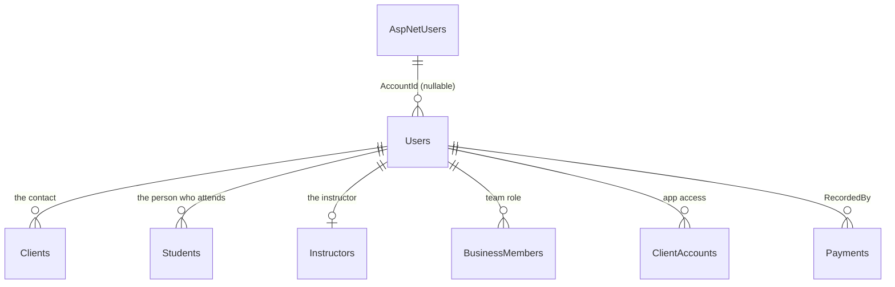

# Users per business

Status: built (steps 1 to 6).

## Why

Today a person shows up in several places, and each place keeps its own copy of their data:

| Where | Name | Email | Phone | Birth date | Account |
|---|---|---|---|---|---|
| `identity.AspNetUsers` (the account) | yes | yes (sign-in) | | yes | — |
| `Clients` | yes | yes | yes | | |
| `Students` | yes | yes | | yes | |
| `Instructors` | yes | yes | | | |
| `BusinessMembers` (team) | | | | | `UserId` |
| `ClientAccounts` (app access of a family) | | | | | `UserId` |

And 23 columns store who did something as the **account** id, with no foreign key: `RecordedByUserId` (4 tables), `RegisteredByUserId`, `InvitedByUserId` (2), `ContactAdultConfirmedByUserId`, the 4 user columns of `Orders` and `DeletedByUserId` (11 tenant tables). The column doesn't say whether that id is a team member or a student, and once the account is deleted the name is gone.

The problems:

- **Deleting an account** leaves those ids pointing nowhere, and "registrado por" goes blank.
- **The same person is several rows.** A contact who attends class is a `Client` and a `Student` matched by name (`AttendingContact.IsTheContact`). An owner who teaches is a `BusinessMember` and an `Instructor`.
- **The email is repeated** in four tables, kept in sync by hand ([sign-in emails](../20261006-sign-in-emails/plan.md)).

## The model

Two kinds of person data, with two owners:

| | The account | The user |
|---|---|---|
| Table | `identity.AspNetUsers` (unchanged) | **`Users`** (new, one row per person **per business**) |
| Owner | The app (the person gave it to us) | The business (it registered the person) |
| Holds | Sign-in email, password, birth date, language | Name, contact email, phone, birth date |
| Used for | Signing in, nothing else | Everything inside the business |
| Changed by | Only the person (Mi perfil) | The business, until the person signs in (then the email follows the sign-in email, as today) |
| When the account is deleted | Deleted | Kept. `AccountId` becomes `null` |



### `Users`

| Column | Type | Notes |
|---|---|---|
| `Id` | `uniqueidentifier` | Goes in the token, every table points here |
| `TenantId` | `uniqueidentifier` | Tenant-owned, isolated by the global filter like every business table |
| `FullName` | `nvarchar(120)` | Required |
| `Email` | `nvarchar(254)` null | The only contact email in the business |
| `PhoneNumber` | `nvarchar(...)` null | Moves from `Clients` (required there today, optional here: a child has none) |
| `BirthDate` | `date` null | Moves from `Students` |
| `AccountId` | `uniqueidentifier` null | The `AspNetUsers` id. Set only by accepting an invitation, cleared when the account is deleted |
| `IsDeleted`, `DeletedAt`, `DeletedByUserId` | | `ISoftDeletable`: the business can remove a person, never physically |
| `CreatedAt`, `CreatedByUserId`, `UpdatedAt`, `UpdatedByUserId` | | `IAuditable` (see [Audit columns](#audit-columns)) |

Indexes, all filtered on `[IsDeleted] = 0`:

- Unique (`TenantId`, `AccountId`) where `AccountId` is not null: one person per account in each business.
- (`TenantId`, `PhoneNumber`): not unique. Two people can share a phone (a family phone); the rule that two clients can't have the same contact phone (`client.phone_number_taken`) stays in the use cases (see [step 5](#steps)).
- (`TenantId`, `Email`): unique where `Email` is not null (step 5): one email per person in each business, the rule [sign-in emails](../20261006-sign-in-emails/plan.md) already follows. Two rows with the same email are the same person loaded twice.

### What each table keeps

| Table | Keeps | Loses (moves to `Users`) | Gains |
|---|---|---|---|
| `Clients` | Notes, billing (fee, packs), family | `FullName`, `PhoneNumber`, `Email` | `UserId` (the contact) |
| `Students` | Notes, enrollments, attendance | `FullName`, `BirthDate`, `Email` | `UserId` (the person who attends) |
| `Instructors` | `IsActive`, classes | `FullName`, `Email` | `UserId` |
| `BusinessMembers` | Role, custom role, instructor | `UserId` | `UserId` |
| `ClientAccounts` | Client, student, news seen | `UserId` | `UserId` |

- A contact who attends class is **one** user: the `Client` and the `Student` point to the same row. The name only decides it when the student is created (the app sends the contact's name for "Esta persona viene a clase", and an import row names the student like the contact); after that it is `Student.IsTheContactOf(client)`, the shared user.
- An owner who teaches is one user: the `BusinessMember` and the `Instructor` point to the same row.
- A child without email or phone is a user with only a name and a birth date. Not every user has an account.

### Who did what

The 23 columns keep their names (`RecordedByUserId`, `CreatedByUserId`, `InvitedByUserId`, `DeletedByUserId`...) but now hold a `Users` id, with a real foreign key:

| Table | Columns |
|---|---|
| `Payments`, `ClassPackPurchases`, `MeasurementRecords`, `StockMovements` | `RecordedByUserId` |
| `Orders` | `CreatedByUserId`, `PaymentRecordedByUserId`, `DeliveredByUserId`, `CancelledByUserId` |
| `Clients` | `RegisteredByUserId` |
| `ClientInvitations`, `MemberInvitations` | `InvitedByUserId`, `ContactAdultConfirmedByUserId` |
| The 11 soft deleted tenant tables | `DeletedByUserId` |

After this change, `UserId` means a row of `Users` everywhere in the code, and the account is always `AccountId`. Today `UserId` means the account; the rename removes the only reason the two could be confused.

Showing "registrado por Laura Gómez" becomes a join, and it keeps working after Laura deletes her account.

Outside the tenants, the account id stays, because there is no business there:

| Table | Column | Why |
|---|---|---|
| `OrganizationMembers` (brand owners) | `UserId` | The brand sits above the branches |
| `LegalTermsAcceptances` | `UserId` | The person accepted the app's terms, not a business's |
| `PushSubscriptions`, `MemberPushSubscriptions` | `UserId` | A phone belongs to the account. Deleted with it |

The billing tables belong to the brand, not to a branch, but their `DeletedByUserId` points to `Users` too: when a brand owner changes the plan from the app, it stores the owner's user in the branch they were signed in to (the session is always in a branch). Showing who changed it from another branch reads that row with `IgnoreTenantFilter()`. Changes made by the operator with `scripts/set-subscription.sql` leave it `null`.

## Signing in and the session

1. The person signs in with the email and password of their **account** (unchanged).
2. The app finds their user in the chosen branch: `Users` where `AccountId` = the account and `TenantId` = the branch. This is the only place the account id is used.
3. The token carries a new claim, `user_id` (the `Users` id), next to `tenant_id`. `sub` stays the account id, used by `src/Security` for refresh tokens. Switching branch already issues a new token, so it gets that branch's user.
4. `ICurrentUser.UserId` becomes the `Users` id, and the account id moves to `ICurrentUser.AccountId`, used only by Mi perfil and account deletion. Every use case that saves who did something uses `UserId`.
5. Work with no person (background workers, sign-up before the account exists) leaves the `...ByUserId` columns `null`.

Brand owners act in every branch of their brand. They get a user in each branch: when the branch is created, and for the existing branches in the migration.

### Linking is by account, never by email

`AccountId` is set only when the person accepts an invitation (the link proves they own the inbox), and the account id never changes. Linking by email would break when the person changes their sign-in email, would let anyone who edits a user's email take over their access, and would relink a minor who comes back with a new account without a new guardian consent.

### Emails

| Email | Lives in | Changed by |
|---|---|---|
| Sign-in | `AspNetUsers` only | The person, from Mi perfil. The app then copies it to every user with that `AccountId`, as it does today with `Clients` |
| Contact | `Users` only | The business, while the person has no account. Locked once they sign in (`client.email_used_to_sign_in` today) |

## Audit columns

`Users` and every tenant table implement `IAuditable`, step 2 of the [audit log plan](../20261012-audit-log/plan.md):

```csharp
public interface IAuditable
{
    DateTimeOffset CreatedAt { get; }
    Guid? CreatedByUserId { get; }
    DateTimeOffset? UpdatedAt { get; }
    Guid? UpdatedByUserId { get; }
}
```

- `AuditSaveChangesInterceptor` fills them from `ICurrentUser.UserId`, and `DeletedByUserId` when a row is soft deleted.
- All three `...ByUserId` columns are foreign keys to `Users`, so "creado por" and "borrado por" keep their name after the person deletes their account.
- A test fails if a tenant table doesn't implement it.

## Deleting an account

On top of this model, ["Eliminar mi cuenta"](../../student-accounts.md#pending) is:

| Table | Action |
|---|---|
| `AspNetUsers` and its token tables (cascade) | Deleted |
| `Users` | `AccountId = null` on every row of that account. The row, its name and its history stay: they belong to the business |
| `ClientAccounts`, `BusinessMembers` | Soft deleted |
| `PushSubscriptions`, `MemberPushSubscriptions`, `TeamNotifications` | Deleted |

Nothing points to the account id anymore, so nothing is left pointing nowhere.

## Data migration

One migration per step (see [Steps](#steps)), each with a test that loads data in the previous schema, migrates and checks every row.

0. **Before migrating:** `scripts/list-repeated-emails.sql` lists the emails repeated inside a business, with where each person shows up in the app. Each repetition is the same person loaded twice, or two people sharing an email; the operator fixes them in the app and runs it again until it is empty. Migration `RemovePeopleCopies` stops with an error that names the script if any is left.
1. **People of each business.** For every tenant:
   - Each `Client` → a user with its name, phone and email.
   - Each `Student` → the contact's user when `AttendingContact.IsTheContact` matches (today's rule, used once more), else a new user with its name, birth date and email.
   - Each `Instructor` → a new user, unless a `BusinessMember` with that `InstructorId` already has one.
   - Each `BusinessMember` → its instructor's user if it has one, else a new one named after the account (`identity.AspNetUsers.FullName`, same database, another schema).
   - Each `ClientAccount` → sets `AccountId` on the student's user (or the client's when `StudentId` is null).
   - The same account in the same branch (an owner who is also a student) ends up as **one** user: rows are merged by `AccountId`.
   - Each brand owner → a user in every branch of their brand.
2. **Who did what.** Each `...ByUserId` value becomes the user with that `AccountId` in the row's tenant. A value with no match (an account already deleted, or never in that branch) becomes `null`, and the migration test counts them so none is lost by surprise.

## Steps

Each step is one PR, starts with failing tests, and ships with its migration and docs.

1. **`Users` and links (built).**
   - The table, the backfill (`UsersBackfill`, migration `AddUsers`), and `UserId` on `Clients`, `Students`, `Instructors`, `BusinessMembers` and `ClientAccounts`, nullable until step 5.
   - `BusinessMembers.UserId` and `ClientAccounts.UserId` (the account) are renamed to `AccountId`.
   - Old columns stay and keep working. While they are the source, `UserSyncSaveChangesInterceptor` keeps `Users` in step on every save: it creates the user of a new client, student or instructor, copies name, email, phone and birth date when they change, shares the user of a contact who attends class, links a new team member to their instructor's user (or to the user of their account in that branch, or to a new user named after the account), and links a new student app account to its person. Changing the sign-in email updates `Users` too. The interceptor goes away in step 5.
   - A person already linked to an account in a branch keeps it: another row of the same person is not linked to that account again (one user per account and branch).
2. **Read from `Users` (built).**
   - `Client`, `Student` and `Instructor` have a `User` navigation, set by `LinkUser` (the interceptor links it on save). Repositories include it, and their projections (rosters, bookings, attended classes, fees, announcement audiences) join it.
   - Screens, searches, exports, emails, push and team notices read name, email, phone and birth date from the user. The student export leaves the contact columns empty when the student is the contact's own user, instead of comparing names.
   - What still read the copies (the answers of the commands that write a client, student or instructor, and the write rules) moved with the writes in step 5.
   - Team members and who did what keep the account's name until steps 3 and 4.
3. **Session (built).**
   - The access token carries `user_id`: `SessionUserClaims` looks up the user with that `AccountId` in the token's branch every time a token is issued, refreshed or switched to another branch. No user in that branch, no claim. `src/Security` stays generic: the application passes it as `TokenSubject.Claims`.
   - `ICurrentUser.AccountId` is the account (`sub`) and `ICurrentUser.UserId` is the user (`user_id`). `MemberAccess`, `StudentAppAccess` and `SessionUser` call the account `AccountId` too. Until step 4, the columns that save who did something keep receiving the account (`AccountId`), so old and new rows hold the same kind of id when step 4 migrates them.
   - Invitations set `AccountId`: accepting a team or app invitation links the account to the person's user (the interceptor from step 1, covered by its tests). Sign-up and the branch creator get theirs the same way, through their team membership.
   - Brand owners get a user in every branch of the brand where they have none, named after the account: when a branch is created, when a member is made brand owner (`IUserRepository.AddMissingInEveryBranchAsync`) and, for the brands that already exist, in migration `AddBrandOwnerUsers`. The tenant interceptor refuses writes to another branch, so these rows are inserted with SQL, like the cross-branch email updates.
4. **Who did what (built).**
   - The 23 columns, plus `DeletedByUserId` of `OrganizationMembers`, `billing.Subscriptions` and `billing.SubscriptionFeatures`, hold a `Users` id with a foreign key (`ApplyWhoDidWhatForeignKeys`: every column named `...ByUserId`; a test fails if one has no foreign key to `Users`). `InvitedByUserId` becomes nullable, like the rest.
   - Use cases save `ICurrentUser.UserId`, `MemberAccess.UserId` or `StudentAppAccess.UserId` (the `user_id` claim). "Registrado por" and "medido por" read the name from `Users` (`IUserRepository.ListFullNamesAsync`, deleted users included); `GET /api/me` returns the user as `userId`, so undoing your own payment still compares the same kind of id; the client scope of `.own` permissions and the push to whoever sent an invitation go through the user.
   - Migration `PointWhoDidWhatToUsers` (`WhoDidWhatBackfill`): each value becomes the user with that `AccountId` in the row's branch, or `null` when there is none. The columns outside a branch keep a value only if it is already a `Users` id; nothing wrote them before, so they were empty.
5. **Remove the copies (built).**
   - `Client`, `Student` and `Instructor` create their `User` and change it (`Client.Update`, `Instructor.Update`, `user.ChangeEmail`, `user.ChangeBirthDate`); `User` holds the validation of name, email and birth date, with the same messages and field names. `UserSyncSaveChangesInterceptor` is gone.
   - Team members and student app accounts get their user from `AccountUsers.ResolveAsync` when they are created (sign-up, new branch, accepting an invitation): the person's user if it is free (the instructor, the invited student or contact), else the user of that account in the branch, else a new one named after the account. `BusinessMembers.UserId` and `ClientAccounts.UserId` are the user that signs in, so every query by account goes through `User.AccountId`.
   - Dropped: `FullName`, `Email`, `PhoneNumber`, `BirthDate` of `Clients`, `Students` and `Instructors`, `AccountId` of `BusinessMembers` and `ClientAccounts`, and their indexes. `UserId` is required in the five tables.
   - Rules that lived on those indexes stay, checked by the use cases after taking `IPeopleLock` (`sp_getapplock` per business, in the command's transaction): the contact phone of a client, the instructor's name and the student's name in the family. Imports take the same lock.
   - The email is unique per business (`IX_Users_TenantId_Email`). A form that would repeat it gets `400 user.email_taken` on the email field; an import row gets the same code. A user created for an account (a new team member, a brand owner in another branch) gets the account's email only if nobody in the branch uses it. Changing the sign-in email is refused (`user.email_taken` on `NewEmail`) when another person of one of the account's businesses uses the new one.
   - Migration `RemovePeopleCopies` (`PeopleCopiesRemoval`): gives a user to any row that has none, links each team member and app account to the user of its account (linking the person's user when it is free, or creating one named after the account), stops if an email is repeated (step 0), and then drops the columns.
6. **"Eliminar mi cuenta" (built).**
   - `POST /api/me/account/deletion` with the current password (`DeleteMyAccountUseCase`), from Mi perfil in the team app and the student app: a screen with the password, then `ConfirmDialog`. A wrong password gets `400 auth.invalid_current_password` on `CurrentPassword`, and nothing changes.
   - Refused with `409 brand_owner.last` while the account is the only brand owner of a brand: the brand would have nobody to manage it or its plan. The person makes another team member a brand owner first, or asks to close the business by email ([legal and privacy](../../legal-and-privacy.md)). A brand owner who is not the only one can delete their account; their brand ownership is soft deleted.
   - `IAccountLinkRepository.UnlinkFromEveryBusinessAsync` does the table [above](#deleting-an-account) in every branch with set-based updates (the tenant interceptor refuses writes to another branch): team memberships and student app accounts are soft deleted with `DeletedByUserId` = the person's own user, push subscriptions and team notices are deleted, and `AccountId` becomes `null` on every user of the account, deleted ones included. `ClientAccounts` became `ISoftDeletable` for this (migration `SoftDeleteClientAccounts`). Then the account is deleted in `src/Security`, which deletes its refresh, password reset and email change tokens (cascade). All of it runs in the command's transaction.
   - `LegalTermsAcceptances` keep their rows: they are the proof of what the person accepted and when, and only hold the account id, a version and a date.

Import and export (`src/Core/UseCases/ImportExport`) follow step 2: their columns don't change for the user.

## Decisions

Taken:

1. **Name:** `Users`. The account becomes `AccountId` everywhere, so `UserId` always means a row of `Users`.
2. **`DeletedByUserId`** keeps its name and points to `Users` in every table, the billing tables included. No rename.
3. **Audit:** `Users` and every tenant table implement `IAuditable`. Step 1 gave `Users` only `CreatedAt`; the other three columns come with step 2 of the audit log plan, for every table at once.
4. **Email:** unique per business. Repetitions are fixed before step 5, when the email lives only in `Users` and its index becomes unique.
5. **Phone:** it moves to `Users` too, and is required only for the contact of a client. It is not unique in `Users`: only two clients can't share a contact phone, checked in the use cases.
6. **Order:** this goes before "Eliminar mi cuenta", so deleting is written once on the final model.
7. **Names:** the instructor's name stays unique per business and the student's name unique in the family. With the copies gone no index can hold them, so the use cases check them after taking a lock per business.

## A student who also teaches, in the same branch

The model lets a `Student` and an `Instructor` share one user. Creating an instructor, registering a client or adding a student with an email asks too (see Status below); the two invitations, where the email is required, are where both roles meet:

| Flow (same branch, same email) | Today | Test |
|---|---|---|
| A student with the app joins the team with a role that needs no instructor | Works: the team member reuses the student's user (one row) | `Endpoints/Members/When_a_student_joins_the_team_without_an_instructor` |
| A student is invited to the team as an instructor | Asks "¿Es la misma persona?" (`409 user.same_person`); with "Unir", one user | `Endpoints/Members/When_a_student_is_invited_as_an_instructor`, `When_a_student_is_confirmed_as_the_invited_instructor` |
| An instructor is invited to the student app | Asks "¿Es la misma persona?"; with "Unir", one user | `Endpoints/StudentApp/When_an_instructor_is_invited_to_the_student_app`, `When_an_instructor_is_confirmed_as_the_invited_client` |
| The email belongs to someone who already has that role (another instructor, another client) | `400 user.email_taken`, as before | `When_an_instructor_is_invited_with_the_email_of_another_instructor`, `When_a_student_app_invitation_uses_the_email_of_another_client` |

### Proposal: one person, with a question and a way out

Decided: one `Users` row per person, also when the person has several roles in the branch. What someone did as a student or as an instructor was done by that one person. Splitting a person into one row per role would break the account link (one user per account and branch, one `user_id` in the token), the unique email per branch and the single place to change a name.

The business data hangs from the role, not from the person: enrollments, attendance, measurements, bookings and app access from `Students`; classes, sessions, private lessons and the team member from `Instructors`. `Users` only gets the links and who did what. That is what makes a mistake cheap to undo.

1. **"¿Es la misma persona?"** Creating an instructor, inviting someone to the team as an instructor, registering a client or a student, adding a student to a family, or inviting someone to the student app, with an email that another person of the branch already uses, answers `409` with that person in the details (name, email, and what they are today: student of which classes, instructor, team member). The app asks with `ConfirmDialog`, showing that data, so the business confirms with something concrete in front of it.
   - **Yes:** the request is sent again with that user's id, and the new role points to the existing user: one row. The use case checks that the user belongs to the branch, has that email, and doesn't already have that role.
   - **No:** as today. The person needs another email, or is loaded without one if they won't use the app. Two people never share an email in a branch.
   - Reusing a user never links an account. The account is still linked only by accepting an invitation sent to that email.
2. **"Separar"**, for a "yes" by mistake (two people who share an email). On the student or the instructor, when their user also has another role: the business types the other person's name (and birth date or email if it has them), and the role moves to a new user. Everything that hangs from that role moves with it. Who did what stays with the original user. So does the account, and with it the team membership. The separated person gets their own invitation with their own email. It touches another person, so it asks first with `ConfirmDialog`.
3. **Nothing is deleted.** The business can't delete the account (only the person can, from "Eliminar mi cuenta"), and fixing a mistake never needs deleting a role and loading it again, which would lose its history.

Status:

- [x] **The question in the two invitations** (team invitation as an instructor, student app invitation). `SamePerson.FindAsync` (`src/Core/UseCases/Users`) finds the other person with that email and checks they can take the role: not an instructor or team member yet for the team, not a client or student yet for the student app. Without `SamePersonUserId` it answers `409 user.same_person` with `samePersonUserId` and `samePersonFullName`; with it, the instructor (or the client, and the students that share its user) moves to that user, which keeps its name and email and takes the phone and birth date it lacked (`User.CompleteWith`), and the user left without roles is soft deleted. The app asks with `SamePersonDialog` (**Volver** / **Unir**); **Volver** shows the email error of today.
- [x] **The question when creating** an instructor, registering a client (the contact's email) or adding a student to a family. The same `SamePerson.FindAsync` and `SamePersonDialog`; with "Unir" the new record is created on the existing user (`Instructor.CreateFor`, `Client.CreateFor`, `Student.CreateFor`), so no second user is made, and the user takes the phone or birth date typed in the form. The person can't take the role when they already have it: another instructor, another contact, or a student (a student is one per family and the name rule is per family). Imports don't ask: the row keeps `user.email_taken`.
- [ ] "Separar".
