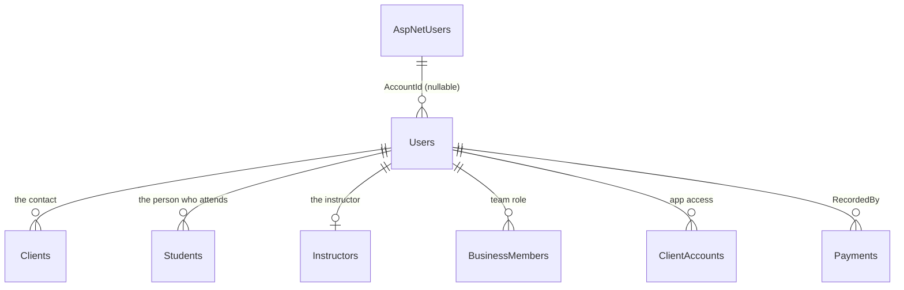

# Users per business

Status: steps 1 to 3 built; the rest are the next PRs.

## Why

Today a person shows up in several places, and each place keeps its own copy of their data:

| Where | Name | Email | Phone | Birth date | Account |
|---|---|---|---|---|---|
| `identity.AspNetUsers` (the account) | yes | yes (sign-in) | | yes | — |
| `Clients` | yes | yes | yes | | |
| `Students` | yes | yes | | yes | |
| `Instructors` | yes | yes | | | |
| `BusinessMembers` (team) | | | | | `UserId` |
| `ClientAccounts` (app access of a family) | | | | | `UserId` |

And 23 columns store who did something as the **account** id, with no foreign key: `RecordedByUserId` (4 tables), `RegisteredByUserId`, `InvitedByUserId` (2), `ContactAdultConfirmedByUserId`, the 4 user columns of `Orders` and `DeletedByUserId` (11 tenant tables). The column doesn't say whether that id is a team member or a student, and once the account is deleted the name is gone.

The problems:

- **Deleting an account** leaves those ids pointing nowhere, and "registrado por" goes blank.
- **The same person is several rows.** A contact who attends class is a `Client` and a `Student` matched by name (`AttendingContact.IsTheContact`). An owner who teaches is a `BusinessMember` and an `Instructor`.
- **The email is repeated** in four tables, kept in sync by hand ([sign-in emails](../20261006-sign-in-emails/plan.md)).

## The model

Two kinds of person data, with two owners:

| | The account | The user |
|---|---|---|
| Table | `identity.AspNetUsers` (unchanged) | **`Users`** (new, one row per person **per business**) |
| Owner | The app (the person gave it to us) | The business (it registered the person) |
| Holds | Sign-in email, password, birth date, language | Name, contact email, phone, birth date |
| Used for | Signing in, nothing else | Everything inside the business |
| Changed by | Only the person (Mi perfil) | The business, until the person signs in (then the email follows the sign-in email, as today) |
| When the account is deleted | Deleted | Kept. `AccountId` becomes `null` |



### `Users`

| Column | Type | Notes |
|---|---|---|
| `Id` | `uniqueidentifier` | Goes in the token, every table points here |
| `TenantId` | `uniqueidentifier` | Tenant-owned, isolated by the global filter like every business table |
| `FullName` | `nvarchar(120)` | Required |
| `Email` | `nvarchar(254)` null | The only contact email in the business |
| `PhoneNumber` | `nvarchar(...)` null | Moves from `Clients` (required there today, optional here: a child has none) |
| `BirthDate` | `date` null | Moves from `Students` |
| `AccountId` | `uniqueidentifier` null | The `AspNetUsers` id. Set only by accepting an invitation, cleared when the account is deleted |
| `IsDeleted`, `DeletedAt`, `DeletedByUserId` | | `ISoftDeletable`: the business can remove a person, never physically |
| `CreatedAt`, `CreatedByUserId`, `UpdatedAt`, `UpdatedByUserId` | | `IAuditable` (see [Audit columns](#audit-columns)) |

Indexes, all filtered on `[IsDeleted] = 0`:

- Unique (`TenantId`, `AccountId`) where `AccountId` is not null: one person per account in each business.
- (`TenantId`, `PhoneNumber`): unique once the phone lives only here (step 5). Until then `Clients` keeps today's rule (`client.phone_number_taken`).
- (`TenantId`, `Email`): unique once the email lives only here (step 5): one email per person in each business, the rule [sign-in emails](../20261006-sign-in-emails/plan.md) already follows. Two rows with the same email are the same person loaded twice. Until then the copies in `Clients`, `Students` and `Instructors` allow repetitions, so the index is not unique yet.

### What each table keeps

| Table | Keeps | Loses (moves to `Users`) | Gains |
|---|---|---|---|
| `Clients` | Notes, billing (fee, packs), family | `FullName`, `PhoneNumber`, `Email` | `UserId` (the contact) |
| `Students` | Notes, enrollments, attendance | `FullName`, `BirthDate`, `Email` | `UserId` (the person who attends) |
| `Instructors` | `IsActive`, classes | `FullName`, `Email` | `UserId` |
| `BusinessMembers` | Role, custom role, instructor | `UserId` | `UserId` |
| `ClientAccounts` | Client, student, news seen | `UserId` | `UserId` |

- A contact who attends class is **one** user: the `Client` and the `Student` point to the same row. `AttendingContact.IsTheContact` (matching by name) goes away.
- An owner who teaches is one user: the `BusinessMember` and the `Instructor` point to the same row.
- A child without email or phone is a user with only a name and a birth date. Not every user has an account.

### Who did what

The 23 columns keep their names (`RecordedByUserId`, `CreatedByUserId`, `InvitedByUserId`, `DeletedByUserId`...) but now hold a `Users` id, with a real foreign key:

| Table | Columns |
|---|---|
| `Payments`, `ClassPackPurchases`, `MeasurementRecords`, `StockMovements` | `RecordedByUserId` |
| `Orders` | `CreatedByUserId`, `PaymentRecordedByUserId`, `DeliveredByUserId`, `CancelledByUserId` |
| `Clients` | `RegisteredByUserId` |
| `ClientInvitations`, `MemberInvitations` | `InvitedByUserId`, `ContactAdultConfirmedByUserId` |
| The 11 soft deleted tenant tables | `DeletedByUserId` |

After this change, `UserId` means a row of `Users` everywhere in the code, and the account is always `AccountId`. Today `UserId` means the account; the rename removes the only reason the two could be confused.

Showing "registrado por Laura Gómez" becomes a join, and it keeps working after Laura deletes her account.

Outside the tenants, the account id stays, because there is no business there:

| Table | Column | Why |
|---|---|---|
| `OrganizationMembers` (brand owners) | `UserId` | The brand sits above the branches |
| `LegalTermsAcceptances` | `UserId` | The person accepted the app's terms, not a business's |
| `PushSubscriptions`, `MemberPushSubscriptions` | `UserId` | A phone belongs to the account. Deleted with it |

The billing tables belong to the brand, not to a branch, but their `DeletedByUserId` points to `Users` too: when a brand owner changes the plan from the app, it stores the owner's user in the branch they were signed in to (the session is always in a branch). Showing who changed it from another branch reads that row with `IgnoreTenantFilter()`. Changes made by the operator with `scripts/set-subscription.sql` leave it `null`.

## Signing in and the session

1. The person signs in with the email and password of their **account** (unchanged).
2. The app finds their user in the chosen branch: `Users` where `AccountId` = the account and `TenantId` = the branch. This is the only place the account id is used.
3. The token carries a new claim, `user_id` (the `Users` id), next to `tenant_id`. `sub` stays the account id, used by `src/Security` for refresh tokens. Switching branch already issues a new token, so it gets that branch's user.
4. `ICurrentUser.UserId` becomes the `Users` id, and the account id moves to `ICurrentUser.AccountId`, used only by Mi perfil and account deletion. Every use case that saves who did something uses `UserId`.
5. Work with no person (background workers, sign-up before the account exists) leaves the `...ByUserId` columns `null`.

Brand owners act in every branch of their brand. They get a user in each branch: when the branch is created, and for the existing branches in the migration.

### Linking is by account, never by email

`AccountId` is set only when the person accepts an invitation (the link proves they own the inbox), and the account id never changes. Linking by email would break when the person changes their sign-in email, would let anyone who edits a user's email take over their access, and would relink a minor who comes back with a new account without a new guardian consent.

### Emails

| Email | Lives in | Changed by |
|---|---|---|
| Sign-in | `AspNetUsers` only | The person, from Mi perfil. The app then copies it to every user with that `AccountId`, as it does today with `Clients` |
| Contact | `Users` only | The business, while the person has no account. Locked once they sign in (`client.email_used_to_sign_in` today) |

## Audit columns

`Users` and every tenant table implement `IAuditable`, step 2 of the [audit log plan](../20261012-audit-log/plan.md):

```csharp
public interface IAuditable
{
    DateTimeOffset CreatedAt { get; }
    Guid? CreatedByUserId { get; }
    DateTimeOffset? UpdatedAt { get; }
    Guid? UpdatedByUserId { get; }
}
```

- `AuditSaveChangesInterceptor` fills them from `ICurrentUser.UserId`, and `DeletedByUserId` when a row is soft deleted.
- All three `...ByUserId` columns are foreign keys to `Users`, so "creado por" and "borrado por" keep their name after the person deletes their account.
- A test fails if a tenant table doesn't implement it.

## Deleting an account

On top of this model, ["Eliminar mi cuenta"](../../student-accounts.md#pending) is:

| Table | Action |
|---|---|
| `AspNetUsers` and its token tables (cascade) | Deleted |
| `Users` | `AccountId = null` on every row of that account. The row, its name and its history stay: they belong to the business |
| `ClientAccounts`, `BusinessMembers` | Soft deleted |
| `PushSubscriptions`, `MemberPushSubscriptions`, `TeamNotifications` | Deleted |

Nothing points to the account id anymore, so nothing is left pointing nowhere.

## Data migration

One migration per step (see [Steps](#steps)), each with a test that loads data in the previous schema, migrates and checks every row.

0. **Before migrating:** a query lists the emails repeated inside a business (`Clients`, `Students`, `Instructors` together). Each repetition is the same person loaded twice, or two people sharing an email; the operator fixes them in the app before the migration, which fails if any is left (the unique index rejects it).
1. **People of each business.** For every tenant:
   - Each `Client` → a user with its name, phone and email.
   - Each `Student` → the contact's user when `AttendingContact.IsTheContact` matches (today's rule, used once more), else a new user with its name, birth date and email.
   - Each `Instructor` → a new user, unless a `BusinessMember` with that `InstructorId` already has one.
   - Each `BusinessMember` → its instructor's user if it has one, else a new one named after the account (`identity.AspNetUsers.FullName`, same database, another schema).
   - Each `ClientAccount` → sets `AccountId` on the student's user (or the client's when `StudentId` is null).
   - The same account in the same branch (an owner who is also a student) ends up as **one** user: rows are merged by `AccountId`.
   - Each brand owner → a user in every branch of their brand.
2. **Who did what.** Each `...ByUserId` value becomes the user with that `AccountId` in the row's tenant. A value with no match (an account already deleted, or never in that branch) becomes `null`, and the migration test counts them so none is lost by surprise.

## Steps

Each step is one PR, starts with failing tests, and ships with its migration and docs.

1. **`Users` and links (built).**
   - The table, the backfill (`UsersBackfill`, migration `AddUsers`), and `UserId` on `Clients`, `Students`, `Instructors`, `BusinessMembers` and `ClientAccounts`, nullable until step 5.
   - `BusinessMembers.UserId` and `ClientAccounts.UserId` (the account) are renamed to `AccountId`.
   - Old columns stay and keep working. While they are the source, `UserSyncSaveChangesInterceptor` keeps `Users` in step on every save: it creates the user of a new client, student or instructor, copies name, email, phone and birth date when they change, shares the user of a contact who attends class, links a new team member to their instructor's user (or to the user of their account in that branch, or to a new user named after the account), and links a new student app account to its person. Changing the sign-in email updates `Users` too. The interceptor goes away in step 5.
   - A person already linked to an account in a branch keeps it: another row of the same person is not linked to that account again (one user per account and branch).
2. **Read from `Users` (built).**
   - `Client`, `Student` and `Instructor` have a `User` navigation, set by `LinkUser` (the interceptor links it on save). Repositories include it, and their projections (rosters, bookings, attended classes, fees, announcement audiences) join it.
   - Screens, searches, exports, emails, push and team notices read name, email, phone and birth date from the user. The student export leaves the contact columns empty when the student is the contact's own user, instead of comparing names.
   - What still reads the copies: the commands that write a client, student or instructor answer with what they wrote (`FromWritten`), and the write rules stay on the columns they protect (unique phone and names, `AttendingContact`, `FamilyEmails`, the email locked by the sign-in, the address an app invitation goes to). Both move with the writes in step 5.
   - Team members and who did what keep the account's name until steps 3 and 4.
3. **Session (built).**
   - The access token carries `user_id`: `SessionUserClaims` looks up the user with that `AccountId` in the token's branch every time a token is issued, refreshed or switched to another branch. No user in that branch, no claim. `src/Security` stays generic: the application passes it as `TokenSubject.Claims`.
   - `ICurrentUser.AccountId` is the account (`sub`) and `ICurrentUser.UserId` is the user (`user_id`). `MemberAccess`, `StudentAppAccess` and `SessionUser` call the account `AccountId` too. Until step 4, the columns that save who did something keep receiving the account (`AccountId`), so old and new rows hold the same kind of id when step 4 migrates them.
   - Invitations set `AccountId`: accepting a team or app invitation links the account to the person's user (the interceptor from step 1, covered by its tests). Sign-up and the branch creator get theirs the same way, through their team membership.
   - Brand owners get a user in every branch of the brand where they have none, named after the account: when a branch is created, when a member is made brand owner (`IUserRepository.AddMissingInEveryBranchAsync`) and, for the brands that already exist, in migration `AddBrandOwnerUsers`. The tenant interceptor refuses writes to another branch, so these rows are inserted with SQL, like the cross-branch email updates.
4. **Who did what.** The 23 columns become `...ByUserId` with foreign keys, plus the data migration.
5. **Remove the copies.** Writes go to `Users`, the interceptor goes away, and `Email`, `FullName`, `PhoneNumber`, `BirthDate` are dropped from `Clients`, `Students` and `Instructors`, `AccountId` from `BusinessMembers` and `ClientAccounts`, and `AttendingContact`. `UserId` becomes required, and the email and phone indexes become unique after fixing the repetitions (data migration, step 0).
6. **"Eliminar mi cuenta"**, as described above.

Import and export (`src/Core/UseCases/ImportExport`) follow step 2: their columns don't change for the user.

## Decisions

Taken:

1. **Name:** `Users`. The account becomes `AccountId` everywhere, so `UserId` always means a row of `Users`.
2. **`DeletedByUserId`** keeps its name and points to `Users` in every table, the billing tables included. No rename.
3. **Audit:** `Users` and every tenant table implement `IAuditable`. Step 1 gave `Users` only `CreatedAt`; the other three columns come with step 2 of the audit log plan, for every table at once.
4. **Email:** unique per business. Repetitions are fixed before step 5, when the email lives only in `Users` and its index becomes unique.
5. **Phone:** it moves to `Users` too, and is required only for the contact of a client.
6. **Order:** this goes before "Eliminar mi cuenta", so deleting is written once on the final model.
