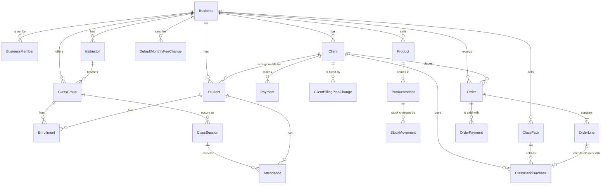

# Domain model

Entities, invariants and tenancy rules. Everything here lives in `src/Core/Domain` and has no dependency on EF Core or ASP.NET.

## Principles

- **Entities protect their own invariants.** They are created through a static `Create(...)` factory that returns `Result<TEntity>`; properties have private setters. An invalid entity cannot exist in memory.
- **Identifiers are `Guid` version 7** (`Guid.CreateVersion7()`): sortable by creation time and index-friendly in SQL Server.
- **Time is stored as UTC `DateTimeOffset`.** Conversions to local time use the business's `TimeZoneId`. Current time always comes from `TimeProvider`, never `DateTimeOffset.UtcNow`, so tests control the clock.
- **Money is `decimal`**, in the business's currency, with 2 decimal places.
- **Validation limits are constants** in the entity (for example `User.FullNameMaxLength`), reused by EF Core configuration and by use case validation.

## Entities



### Business (tenant root)

| Property | Type | Rules |
|---|---|---|
| `Id` | `Guid` | v7 |
| `Name` | `string` | Required, 2–120 characters |
| `Slug` | `string` | Required, unique globally, lowercase, 3–80 characters |
| `CountryCode` | `string` | ISO 3166-1 alpha-2, references `Countries` (see [Countries](../countries.md)) |
| `TimeZoneId` | `string` | IANA id, one of the country's time zones, for example `America/Argentina/Buenos_Aires` |
| `DefaultCountryCallingCode` | `string` | The calling code of the country, for example `54`; used to normalize local phone numbers |
| `CurrencyCode` | `string` | ISO 4217, 3 letters, for example `ARS`; normalized to upper case |
| `CreatedAt` | `DateTimeOffset` | UTC |

`Business` is the only entity that does **not** implement `ITenantOwned`.

### BusinessMember

Links a user account to a business with a role. For now every business has exactly one member, the owner.

| Property | Type | Rules |
|---|---|---|
| `Id` | `Guid` | v7 |
| `TenantId` | `Guid` | Tenant (the business) |
| `UserId` | `Guid` | The person in this business ([`User`](#user)), whose `AccountId` is the account that signs in |
| `Role` | `BusinessRole` | `Owner` for now; add roles as the app needs them |

Unique `(TenantId, UserId)` among the members not deleted. The access token carries the member's `TenantId` as the `tenant_id` claim and the role as `role`.

### User

One person in one business: name, contact email, phone, birth date and, when they have one, the account they sign in with (`AccountId`). Clients, students, instructors, team members and student app accounts point to it with `UserId` (required). It belongs to the business and is soft deleted, so it stays when the person deletes their account. See [Users per business](20261017-users/plan.md).

| Property | Type | Rules |
|---|---|---|
| `FullName` | `string` | Required, trimmed, 2–120 characters |
| `Email` | `string?` | Optional, valid format, max 254 characters, **unique per business** (`user.email_taken`) |
| `PhoneNumber` | `PhoneNumber?` | Required only for the contact of a client; not unique (two people can share a phone) |
| `BirthDate` | `DateOnly?` | Optional, from 1900-01-01 to today in the business's time zone |
| `AccountId` | `Guid?` | Identity account id (accounts live in `SecurityDbContext`, schema `identity`); unique per business |

`Client`, `Student` and `Instructor` reach it through the `User` navigation and have no copy of these columns: they create their user (`Client.Create`, `Student.Create`, `Instructor.Create`), and a contact who attends class is a student that shares the client's user (`Student.CreateAttendingContact`). Use cases that create or change people take `IPeopleLock` (one `sp_getapplock` per business) before checking the rules no index enforces: the contact's phone, the instructor's name and the student's name in the family.

The columns that say who did something (`RecordedByUserId`, `RegisteredByUserId`, `InvitedByUserId`, `DeletedByUserId`...) hold a `User` id with a foreign key, so the name stays after the person deletes their account.

### Client

| Property | Type | Rules |
|---|---|---|
| `Id` | `Guid` | v7 |
| `TenantId` | `Guid` | Tenant (the business) |
| `UserId` | `Guid` | The contact ([`User`](#user)): name, email and phone, **unique phone per business** among contacts (`client.phone_number_taken`) |
| `Notes` | `string?` | Optional, max 1000 characters  |
| `CreatedAt` | `DateTimeOffset` | UTC |

### Student (added in M1)

The person who attends classes. The client is who pays and is contacted; an adult who attends is a client with a student that shares the client's user.

| Property | Type | Rules |
|---|---|---|
| `Id` | `Guid` | v7 |
| `TenantId` | `Guid` | Tenant (the business) |
| `ClientId` | `Guid` | Required; the client must belong to the same business |
| `UserId` | `Guid` | The person ([`User`](#user)): name (**unique per client**), birth date and email |
| `Notes` | `string?` | Optional, max 1000 characters (for example "afraid of deep water") |
| `CreatedAt` | `DateTimeOffset` | UTC |

Index: `(TenantId, ClientId)`.

### Instructor (added in M2)

| Property | Type | Rules |
|---|---|---|
| `Id` | `Guid` | v7 |
| `TenantId` | `Guid` | Tenant (the business) |
| `UserId` | `Guid` | The person ([`User`](#user)): name (**unique per business**) and email |
| `IsActive` | `bool` | Can't be deactivated while teaching active class groups |

Completing the sign-up (the link in the confirmation email) creates the owner as the first instructor.

### ClassGroup (added in M2)

A weekly recurring class, for example "Natación inicial, Tuesday and Thursday 18:00, 45 minutes, 8 spots".

| Property | Type | Rules |
|---|---|---|
| `Id` | `Guid` | v7 |
| `TenantId` | `Guid` | Tenant (the business) |
| `Name` | `string` | Required, trimmed, 2–80 characters |
| `InstructorId` | `Guid` | An active instructor of the same business |
| `Weekdays` | `ClassWeekdays` | Flags (`Monday = 1 … Sunday = 64`), at least one; stored as `int` |
| `StartTime` | `TimeOnly` | Wall-clock time in the business's time zone, stored as `time`, never converted to UTC |
| `DurationMinutes` | `int` | 15–240, multiple of 5, ends by midnight |
| `Capacity` | `int` | 1–100 |
| `Location` | `string?` | Optional, max 80 characters |
| `IsActive` | `bool` | Inactive groups are hidden from the weekly view |

`ClassSchedule` (weekdays, start time, duration) is the value object behind it: it validates the time rules and answers `OverlapsWith` (shares a weekday and the time ranges intersect; touching ends don't overlap). An instructor can't teach two active class groups that overlap.

### Enrollment (added in M3)

A student in a class group from a date until they leave.

| Property | Type | Rules |
|---|---|---|
| `Id` | `Guid` | v7 |
| `TenantId` | `Guid` | Tenant (the business) |
| `StudentId` | `Guid` | A student of the same business |
| `ClassGroupId` | `Guid` | An active class group of the same business when enrolling |
| `StartDate` | `DateOnly` | Defaults to today in the business's time zone |
| `EndDate` | `DateOnly?` | Last day attended; `null` while enrolled; never before `StartDate` (ending before the start deletes the enrollment) |
| `CreatedAt` | `DateTimeOffset` | UTC |

An enrollment is **current** on a date when `EndDate` is `null` or on/after that date. A student has at most one open enrollment per class group (filtered unique index `(TenantId, StudentId, ClassGroupId) WHERE EndDate IS NULL`), and current enrollments never exceed the class group's capacity (checked in the use case). A class group with current enrollments can't be deactivated, and its capacity can't drop below them.

"Today" comes from `IBusinessCalendarService`, which applies the business's time zone to `TimeProvider`.

### ClassSession (added in M4)

One date of a class group. Created on demand, only when attendance is taken or the class is cancelled for that date; the day view merges the class groups that meet on the weekday with the sessions stored for the date.

| Property | Type | Rules |
|---|---|---|
| `Id` | `Guid` | v7 |
| `TenantId` | `Guid` | Tenant (the business) |
| `ClassGroupId` | `Guid` | The class group must meet on that weekday |
| `Date` | `DateOnly` | Unique per class group |
| `IsCancelled` | `bool` | A cancelled session takes no attendance; a session with attendance can't be cancelled |
| `CancellationReason` | `string?` | Optional, max 200 characters |
| `RescheduledStartTime` | `TimeOnly?` | Start time for that date only; null is the class group's time |
| `SubstituteInstructorId` | `Guid?` | Active instructor who teaches that date instead of the class group's instructor ([plan](20260929-session-substitutes/plan.md)) |
| `CreatedAt` | `DateTimeOffset` | UTC |

### Attendance (added in M4)

| Property | Type | Rules |
|---|---|---|
| `Id` | `Guid` | v7 |
| `TenantId` | `Guid` | Tenant (the business) |
| `ClassSessionId` | `Guid` | Session of the same business |
| `StudentId` | `Guid` | Enrolled in the class on that date (started on or before it and not ended before it) |
| `Status` | `AttendanceStatus` | `Present` or `Absent`, stored as a string; no row means not taken yet |

Unique `(TenantId, ClassSessionId, StudentId)`. Attendance can only be taken for today or past dates.

### Payment (added in M5)

Money received from a client for a month. The fee is per client (a client pays one fee).

| Property | Type | Rules |
|---|---|---|
| `Id` | `Guid` | v7 |
| `TenantId` | `Guid` | Tenant (the business) |
| `ClientId` | `Guid` | A client of the same business |
| `Amount` | `decimal` | Greater than 0, at most 10,000,000, 2 decimals, `decimal(12,2)` |
| `Month` | `DateOnly` | First day of the month it pays (`BillingMonth`), from 2000-01 to 12 months ahead |
| `PaidOn` | `DateOnly` | Not after today |
| `Method` | `PaymentMethod` | `Cash`, `Transfer`, `Card`, `Other`, stored as a string |
| `Notes` | `string?` | Optional, max 200 characters |
| `CreatedAt` | `DateTimeOffset` | UTC |

A month's fees list the clients with a student enrolled at any point of that month and a monthly plan that month. Effective fee: the client's own fee (`CustomFee` plan), else the business's default fee in force that month, else none. Status: `Paid` (paid ≥ fee), `Partial`, `Unpaid` or `NoFee`.

### DefaultMonthlyFeeChange (added in M6)

The business's default fee from a month on. The fee of a month is the change with the latest `EffectiveFrom` on or before it; earlier months keep theirs. Replaced `Business.DefaultMonthlyFee`.

| Property | Type | Rules |
|---|---|---|
| `EffectiveFrom` | `DateOnly` | First day of a month, 2000-01 to 12 months ahead; unique per business |
| `Amount` | `decimal?` | Same rule as payments; `null` removes the default fee from that month |

### ClientBillingPlanChange (added in M6)

How a client pays from a month on. No change means `BusinessFee`. Replaced `Client.MonthlyFee`.

| Property | Type | Rules |
|---|---|---|
| `ClientId` | `Guid` | A client of the same business |
| `EffectiveFrom` | `DateOnly` | First day of a month, 2000-01 to 12 months ahead; unique per client |
| `Kind` | `BillingPlanKind` | `BusinessFee`, `CustomFee` or `ClassPacks`, stored as a string |
| `CustomFee` | `decimal?` | Required for `CustomFee`, `null` otherwise |

### ClassPack (added in M6)

An item of the business's catalog: "Clase suelta" (1 class), "4 clases", "8 clases en 2 meses".

| Property | Type | Rules |
|---|---|---|
| `Name` | `string` | 2–60 characters, unique per business |
| `ClassCount` | `int` | 1–100 |
| `Price` | `decimal` | Same rule as payments |
| `ValidityMonths` | `int?` | 1–24; `null` means the classes never expire |
| `IsActive` | `bool` | Inactive packs can't be sold |

### ClassPackPurchase (added in M6)

A pack sold to a client; it is also the payment. Copies name, classes and expiry from the catalog so later edits don't change it.

| Property | Type | Rules |
|---|---|---|
| `ClientId`, `ClassPackId` | `Guid` | Of the same business |
| `Price` | `decimal` | The catalog price unless lowered for a discount |
| `PurchasedOn` | `DateOnly` | Not after today |
| `ExpiresOn` | `DateOnly?` | `PurchasedOn` + validity − 1 day; `null` without validity |
| `Method`, `Notes` | | Same rules as payments |

**Class balance** (computed, not stored): each `Present` attendance of the client's students in a month when the client was on `ClassPacks`, oldest first, uses a class of the pack valid on that date that expires first (packs without expiry last). Attendances left without a pack are unpaid classes; classes left in an expired pack are lost.

### Product and ProductVariant (added with the shop)

Anything a branch sells besides classes: caps, swimsuits, brand merchandise.

| Property | Type | Rules |
|---|---|---|
| `Name` | `string` | 2–60 characters, unique per business |
| `Description` | `string?` | Up to 500 characters |
| `Price` | `decimal` | VAT included; same rule as payments |
| `StockMode` | `StockMode` | `Unlimited` (no stock kept), `Tracked` (can't sell more than the stock) or `TrackedWithBackorder` (stock counted, can go below 0) |
| `IsVisibleInApp` | `bool` | Shown in the client app (step 3) or only at the counter |
| `IsActive` | `bool` | Inactive products can't be sold |

A product and a class pack have an ordered list of **photos** (`ProductImage`, `ClassPackImage`: owner, `DocumentId`, `Position`); the first is the main photo. Up to 5 per product and 1 per class pack, a fixed rule; the plan limits the total size of the files (`document-storage`). See [Document](#document-added-with-catalog-photos).

A product has 1–20 **variants** (sizes or colors, names up to 30 characters, unique per product ignoring case). A product without sizes has one unnamed variant. Removing a size deactivates it, so its history stays.

### StockMovement (added with the shop)

Append-only ledger per variant; the stock is the sum of `Quantity`.

| `Kind` | `Quantity` | Created by |
|---|---|---|
| `Restock` | 1–10,000 | Loading stock |
| `Adjustment` | ±1–10,000, not leaving the stock below 0, with a note | Correcting a count (broken, lost) |
| `Sale` | −units | A counter sale with tracked products |
| `Refund` | +units | Refunding units that came back to the shelf |
| `Reservation` | −units | A client's order; it stays as the sale |
| `Cancellation` | +units | Releasing a reservation when the order is cancelled |

Checking and taking stock (counter sales and client orders) runs in a transaction under a SQL Server application lock per variant (`sp_getapplock`, resource `stock:<variant id>`, taken in id order, 10 s timeout), so two sales can't both take the last unit.

### Order and OrderLine (added with the shop)

One purchase: at the counter now, from the client app in step 3.

| Property | Type | Rules |
|---|---|---|
| `Number` | `int` | Visible order number, consecutive **per business** starting at 1 (`n.º 1043`), unique per tenant. Counter sales and app orders share the sequence. Shown in the order lists, emails and team notifications; URLs and the API keep using `Id` |
| `ClientId` | `Guid?` | Required when a line is a class pack; a counter sale of products can have no client |
| `Channel` | `OrderChannel` | `Counter` or `App` |
| `Status` | `OrderStatus` | `Pending` → `Delivered`, or `Pending` → `Cancelled`. Only says whether it was handed over; a counter sale handed over at once starts `Delivered` |
| `PaymentStatus` | `OrderPaymentStatus` | Computed from its payments: `Unpaid`, `Partial` or `Paid` |
| `Notes` | | Same rules as payments |

**Payments** (`OrderPayment`: `Amount`, `Method`, `PaidOn`, `RecordedByUserId`, soft deletable) are one or more per order, each at most what is left to pay. `Balance = Total − RefundedAmount − PaidAmount`, never below 0. See [orders paid in parts](20261020-order-partial-payments/plan.md).

Lines (1–20) keep a snapshot of name and price. A **class pack line** creates the `ClassPackPurchase` when the order is handed over (whole, with its products, paid or not); that purchase can only be undone by refunding the order (`409 class_pack_purchase.from_order`). A **product line** (variant, 1–99 units) records a `Sale` movement for tracked products; the order **awaits pickup** while it is `Pending` with product lines, until it is marked delivered.

An order with products is delivered by **pickup** at the branch or **in class** (`DeliveryClassGroupId`: a class group one of the client's students is enrolled in; the instructor of that class sees it and hands it over). `ReadyAt` records when the branch marked it ready to hand over.

A client's order reserves its tracked units. The branch records payments, hands it over or cancels it; the client can cancel it too while it has no payment. A client's order without any payment 7 days after it was placed is cancelled by a background job (`ExpiredOrderCancellationWorker`, every hour, one business at a time) and its units are released.

**Numbering**: the number is taken inside the transaction that creates the order, with a single atomic `UPDATE Businesses SET NextOrderNumber = NextOrderNumber + 1 OUTPUT deleted.NextOrderNumber` (`IOrderNumbers`). The row lock lasts until the commit, so two orders created at the same time never get the same number, and a rolled-back order gives its number back. The unique index `(TenantId, Number)` is the safety net. The migration `AddOrderNumbers` numbered the orders that already existed, by creation date within each business.

**Refunds**: a product line returns some or all of its units, optionally back to stock. A pack line removes the classes not used yet and refunds their share of the price (the purchase keeps only the used classes, or is removed when none was used).

## Value objects

### PhoneNumber

- Created with `PhoneNumber.Create(string? rawValue, string defaultCountryCode)` returning `Result<PhoneNumber>`.
- Strips spaces, dashes, dots and parentheses; keeps an explicit `+` or `00` international prefix; otherwise drops the leading trunk `0` and adds the business's `DefaultCountryCallingCode`; stores E.164 (`11 2233-4455` → `+541122334455`).
- No country-specific rules: the Argentine mobile `9` is not inserted. Numbers entered with it (`+54 9 11 ...`) are kept as entered.
- Two phone numbers are equal when their normalized values are equal. That is what makes the uniqueness rule reliable.
- Persisted as a single `nvarchar(20)` column via an EF Core value converter.

## Multi-tenancy

One database for all businesses. Isolation is enforced centrally, never by remembering to add a `Where`.

```text
Tenancy/                    (no dependencies, referenced by Core)
  ITenantOwned.cs           → Guid TenantId { get; }
  ITenantContext.cs         → Guid TenantId { get; }  (the current request's business)

Tenancy.AspNetCore/
  Persistence/TenantModelBuilderExtensions.cs        → global query filter for every ITenantOwned entity
  Persistence/TenantStampingSaveChangesInterceptor.cs → sets TenantId on Added entities;
                                                       throws if a Modified entity belongs to another business
  Claims/ClaimsTenantContext.cs                      → reads the tenant_id claim
```

The mechanism has no business concepts so other apps can reuse it; see [tenancy.md](../tenancy.md).

Rules:

- Every tenant-owned table has a `TenantId` column (the business) and an index that **starts** with `TenantId` (for example `IX_Users_TenantId_Email`, unique).
- Every unique rule is scoped per business, for example `(TenantId, Email)`.
- `IgnoreQueryFilters()` is forbidden outside `Infrastructure`. Enforced by the Roslyn analyzer ARCH002 (see [analyzers.md](../analyzers.md)).
- Every new tenant-owned entity needs an integration test in `When_<entity>_belongs_to_another_business/Then_it_is_not_returned.cs`.
- `ITenantContext` is `ClaimsTenantContext`: it reads the `tenant_id` claim of the signed-in user in every environment. HTTP tests authenticate with a real token issued for a test owner; `FixedTenantContext` is used for direct database access.
- Completing the sign-up creates a business before any token exists, so the use case calls `ITenantScope.Establish(tenantId)` for the new business; the stamping interceptor then accepts the owner's `BusinessMember`. A request can only establish one business.
- Sign in and refresh look up `BusinessMember` by the account of its user (`User.AccountId`) with `IgnoreTenantFilter()` inside `Infrastructure` (`BranchDirectory`), because there is no tenant yet.
- A missing or invalid tenant surfaces as `TenantNotResolvedException`, which the global exception handler maps to `401 ProblemDetails`.

## Persistence abstractions

`Core` defines what it needs; `Infrastructure` implements it with EF Core. One interface per aggregate, containing only the methods the use cases need (interface segregation), and no generic repository.

```text
Core/Abstractions/Persistence/
  IClientRepository.cs
  IStudentRepository.cs
  IInstructorRepository.cs
  IClassGroupRepository.cs
  IEnrollmentRepository.cs
  IClassSessionRepository.cs
  IAttendanceRepository.cs
  IPaymentRepository.cs
  IBusinessRepository.cs
  IBusinessMemberRepository.cs
  IUnitOfWork.cs         → Task SaveChangesAsync(CancellationToken)
```

### Document (added with catalog photos)

A file stored in Blob Storage. Rows keep the path, never the file. See [storage](../storage.md).

| Property | Type | Rules |
|---|---|---|
| `Path` | `string` | `<tenantId>/<products\|class-packs>/<ownerId>/<documentId>.<extension>`, up to 300 characters |
| `ContentType` | `string` | Detected from the file's first bytes |
| `SizeInBytes` | `long` | For storage usage per business |
| `Visibility` | `DocumentVisibility` | `Public` (shop photos, served by URL) or `Private` (not used yet; would be served with short-lived signed links) |
| `CreatedAt` | `DateTimeOffset` | |

Owners point to documents through link tables with real foreign keys (`ProductImages`, `ClassPackImages`), not through a generic owner type and id. A new kind of owner is a new link table.
